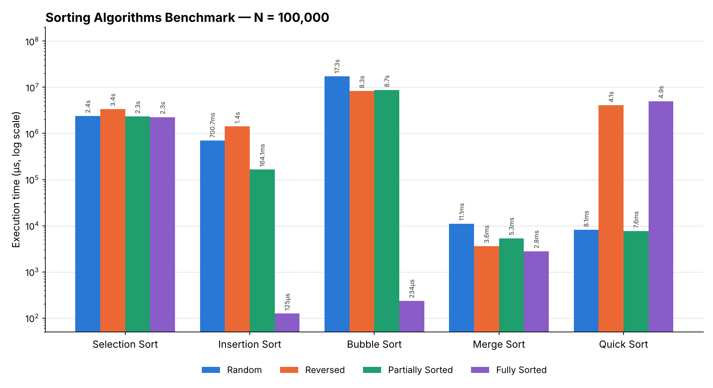

# Sorting Algorithms Benchmark

<div dir="rtl">

## تراكيب البيانات والخوارزميات — نشاط عملي: التحليل والمقارنة التطبيقية لأداء خوارزميات الترتيب

### 👤 البيانات الشخصية

| | |
|---|---|
| **اسم الطالب** | أحمد المبروك الحسيني |
| **الرقم الجامعي** | 3167115 |
| **رقم الشعبة** | ___ |

---

### 📌 وصف المشروع

برنامج بلغة **Java** يقيس زمن تنفيذ خمس خوارزميات ترتيب على مصفوفة بحجم ثابت **N = 100,000** عنصر، في أربع حالات مختلفة للبيانات، ويطبع النتائج بالميكروثانية (µs) في جدول منظم.

**الخوارزميات:** Selection Sort · Insertion Sort · Bubble Sort · Merge Sort · Quick Sort

**حالات البيانات:**
- **Random:** أعداد عشوائية تماماً.
- **Reversed:** مرتبة من الأكبر إلى الأصغر.
- **Partially Sorted:** مرتبة بنسبة ~80% (مصفوفة مرتبة ثم 10,000 تبديل عشوائي، أي ~20% من العناصر في غير مكانها).
- **Fully Sorted:** مرتبة تصاعدياً.

**منهجية القياس:**
- `System.nanoTime()` قبل وبعد استدعاء الخوارزمية، ثم القسمة على 1000 للتحويل إلى ميكروثانية.
- نسخة مستقلة ومطابقة من البيانات الأصلية (`Arrays.copyOf`) قبل كل خوارزمية، والنسخ خارج منطقة القياس.
- بذرة عشوائية ثابتة (seed = 42) لتكون النتائج قابلة للتكرار.
- مرحلة إحماء (Warm-up) للـ JVM على مصفوفات صغيرة قبل القياس، حتى لا يظلم مترجم JIT أول خوارزمية.
- التحقق من صحة الترتيب بعد كل تشغيل.

</div>

### 📂 Project Structure

```
Sorting-Algorithms-Benchmark/
├── src/
│   ├── SortingAlgorithms.java   # The 5 sorting algorithms (commented)
│   ├── DataGenerator.java       # Generates the 4 test cases
│   └── SortingBenchmark.java    # Main program: timing + console table
├── images/
│   └── benchmark_chart.png      # Comparison chart
├── results.csv                  # Raw results
└── README.md                    # This report
```

### ▶️ How to Run

```bash
javac -encoding UTF-8 -d out src/*.java
java -cp out SortingBenchmark
```

---

<div dir="rtl">

### 📊 جدول النتائج (بالميكروثانية µs)

</div>

| Algorithm | Random | Reversely Sorted | Partially Sorted | Fully Sorted |
|---|---:|---:|---:|---:|
| **Selection Sort** | 2,385,746 µs | 3,352,355 µs | 2,329,428 µs | 2,250,520 µs |
| **Insertion Sort** | 700,700 µs | 1,413,939 µs | 164,102 µs | 125 µs |
| **Bubble Sort** | 17,286,003 µs | 8,255,001 µs | 8,711,915 µs | 234 µs |
| **Merge Sort** | 11,070 µs | 3,622 µs | 5,346 µs | 2,773 µs |
| **Quick Sort** | 8,115 µs | 4,077,958 µs | 7,641 µs | 4,939,014 µs |

<div dir="rtl">

> بيئة التشغيل: OpenJDK 21، Linux. الأزمنة تختلف من جهاز لآخر، لكن النسب والاتجاهات تبقى ثابتة.

### 📈 الرسم البياني

المحور الرأسي **لوغاريتمي** لأن الفرق بين أسرع وأبطأ زمن يتجاوز 100,000 ضعف.

</div>



---

<div dir="rtl">

## 🔍 تحليل ومناقشة النتائج

### 1. مقارنة خوارزميات O(N²) مع خوارزميات O(N log N)

الفرق هائل وليس مجرد تحسّن بسيط. في الحالة العشوائية:

| الخوارزمية | الزمن | مقارنة بـ Quick Sort |
|---|---:|---:|
| Quick Sort | ~8 ms | — |
| Merge Sort | ~11 ms | ≈ 1.4× |
| Insertion Sort | ~0.7 s | ≈ 86× أبطأ |
| Selection Sort | ~2.4 s | ≈ 294× أبطأ |
| Bubble Sort | ~17.3 s | ≈ 2,130× أبطأ |

**التفسير:** عند N = 100,000:
- **N²** = 10,000,000,000 (عشرة مليارات عملية تقريباً).
- **N log₂ N** ≈ 100,000 × 17 ≈ 1,700,000 عملية.

أي أن خوارزميات O(N²) تقوم بحوالي **6,000 ضعف** عدد العمليات، وهذا يتطابق مع ترتيب حجم الفروقات المقاسة. كلما كبر N يتسع الفرق أكثر: مضاعفة N تضاعف زمن O(N log N) تقريباً، لكنها تضاعف زمن O(N²) أربع مرات.

**ملاحظات داخل مجموعة O(N²):**
- **Bubble Sort هو الأبطأ** لأنه ينفذ أكبر عدد من عمليات التبديل (swap)، وكل تبديل = 3 عمليات كتابة.
- **Selection Sort** يقوم بنفس عدد المقارنات تقريباً (N²/2) في **كل** الحالات، لذلك زمنه شبه ثابت (~2.3–3.4 s) ولا يستفيد إطلاقاً من كون البيانات مرتبة.
- **Insertion Sort هو الأسرع بين الثلاثة** لأنه يستخدم إزاحة (shift) بدل التبديل، ويتوقف بمجرد إيجاد المكان الصحيح.
- **ملاحظة مثيرة:** Bubble Sort في الحالة العكسية (8.3 s) أسرع من العشوائية (17.3 s) رغم أنه يقوم بتبديلات أكثر! السبب هو **التنبؤ بالتفرعات (Branch Prediction)** في المعالج: في الحالة العكسية الشرط `arr[j] > arr[j+1]` صحيح دائماً فيتنبأ به المعالج بدقة، أما في العشوائية فالشرط عشوائي فيخطئ المعالج كثيراً ويخسر وقتاً في كل خطأ.

### 2. أفضل خوارزمية للبيانات المرتبة والمرتبة جزئياً

**البيانات المرتبة تماماً → Insertion Sort هو الأفضل (125 µs)** متبوعاً بـ Bubble Sort المحسّن (234 µs).
- في المصفوفة المرتبة لا تدخل الحلقة الداخلية لـ Insertion Sort أبداً، فيصبح التعقيد **O(N)**: مرور واحد فقط بـ N−1 مقارنة.
- Bubble Sort مع العلم `swapped` يكتشف في الدورة الأولى أنه لا يوجد أي تبديل فيتوقف → **O(N)** أيضاً.
- كلاهما أسرع حتى من Merge Sort (2.8 ms) لأن Merge Sort يقسم ويدمج دائماً بغض النظر عن حالة البيانات (O(N log N) ثابت).

**البيانات المرتبة جزئياً → Merge Sort (5.3 ms) و Quick Sort (7.6 ms) هما الأفضل.**
- Insertion Sort تحسّن كثيراً (164 ms مقابل 700 ms في العشوائية) لأن زمنه يتناسب مع **عدد الانقلابات (inversions)**، أي O(N + k). لكن مع 20% من العناصر مبعثرة في مواقع بعيدة، يبقى k كبيراً فلا يصل لسرعة O(N log N).
- **الخلاصة:** Insertion Sort ممتاز إذا كانت البيانات "شبه مرتبة" بعدد قليل جداً من العناصر في غير مكانها، أما مع نسبة خلل 20% فخوارزميات O(N log N) أفضل. ولهذا السبب تستخدم مكتبات حقيقية مثل **TimSort** (في Java و Python) مزيجاً من Merge Sort و Insertion Sort.

### 3. سلوك Quick Sort في الحالة العكسية والمرتبة وتأثير المحور (Pivot)

Quick Sort كان **الأسرع** في الحالة العشوائية (8 ms)، لكنه انهار في المرتبة (4.9 s) والمعكوسة (4.1 s) وأصبح **أبطأ ~600 مرة**، في مستوى خوارزميات O(N²).

**السبب: اختيار المحور.** في هذا التطبيق المحور هو **آخر عنصر** في الجزء (Lomuto partition):
- في **المصفوفة المرتبة** آخر عنصر هو دائماً **الأكبر**، فكل العناصر تذهب لليسار ولا شيء لليمين.
- في **المصفوفة المعكوسة** آخر عنصر هو دائماً **الأصغر**، فيحدث العكس.

في الحالتين التقسيم يكون **(N−1) و (0)** بدل نصفين متساويين، فبدل أن ينخفض الحجم للنصف في كل مستوى، ينخفض بعنصر واحد فقط:

```
T(N) = T(N−1) + O(N)  =>  N + (N−1) + (N−2) + ... + 1  =  N(N+1)/2  =  O(N²)
```

**نتيجة جانبية:** عمق الاستدعاء التعاودي (recursion depth) يصل إلى N = 100,000 مستوى بدل log N ≈ 17، وهذا يسبب `StackOverflowError` في الإعداد الافتراضي لـ Java. لذلك يشغّل البرنامج القياس داخل `Thread` بمكدس (stack) حجمه 1 GB.

**في الحالة العشوائية والجزئية** يكون المحور غالباً قريباً من الوسط، فينقسم الجزء لنصفين تقريباً → O(N log N)، ولأن Quick Sort يعمل في المكان (in-place) ولا يحتاج نسخاً لمصفوفة مساعدة، فهو أسرع من Merge Sort عملياً.

**طرق تفادي أسوأ حالة:**
- **Median-of-Three:** اختيار وسيط (أول، وسط، آخر) عنصر كمحور.
- **Random Pivot:** اختيار محور عشوائي، فيصبح احتمال أسوأ حالة ضئيلاً جداً.
- **Introsort:** التحول إلى Heap Sort إذا تجاوز عمق الاستدعاء حداً معيناً (يُستخدم في C++ STL).
- Java نفسها تستخدم **Dual-Pivot Quick Sort** في `Arrays.sort()` للأنواع الأولية.

---

## ✅ الخلاصة

| الحالة | الخوارزمية الأفضل | السبب |
|---|---|---|
| عشوائية | Quick Sort | O(N log N) + في المكان + كفاءة الذاكرة المؤقتة |
| معكوسة | Merge Sort | O(N log N) مضمون، و Quick Sort ينهار بسبب المحور |
| مرتبة جزئياً | Merge Sort / Quick Sort | O(N log N)، ونسبة الخلل 20% كبيرة على Insertion Sort |
| مرتبة تماماً | Insertion Sort | O(N): مرور واحد بلا إزاحات |
| **أداء مضمون في كل الحالات** | **Merge Sort** | **O(N log N) دائماً، لا يتأثر بحالة البيانات** |

</div>
